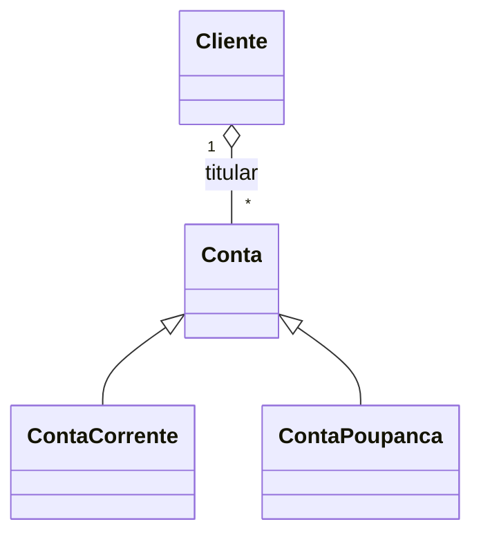

# Sistema orientado a objetos completo

Semana 6; slide(s): 37.

Status: resolvido em Python.

Quatro classes, incluindo Conta abstrata; herança e super(); propriedades validadas; saldo encapsulado; polimorfismo; 15 instâncias na demonstração; exceções tratadas. Taxa de saque de R$ 2,00 na conta corrente e rendimento informado na poupança são regras didáticas adotadas para mostrar comportamentos diferentes.

## Executar

Abra o terminal nesta pasta:

```bash
python principal.py
```

Solução desenvolvida a partir do enunciado; não é transcrição de código já fornecido.
 
## Modelagem



Conta é abstrata porque cada tipo de conta define uma taxa de saque. O saldo não tem setter: só muda por depositar, sacar ou render. A lista de histórico é devolvida por cópia. As subclasses reutilizam a inicialização e sobrescrevem taxa_saque e __str__. Cliente separa os dados do titular das operações da conta.

## Testes

```bash
python -m unittest -v test_banco.py
```

## Exemplo de saída

```text
Corrente: CC-1 | Ana | R$ 138.00
Poupança: CP-1 | Ana | R$ 140.00
...
Instâncias criadas: 15
Saque recusado: Saldo insuficiente.
Nome recusado: Nome não pode ser vazio.
```
